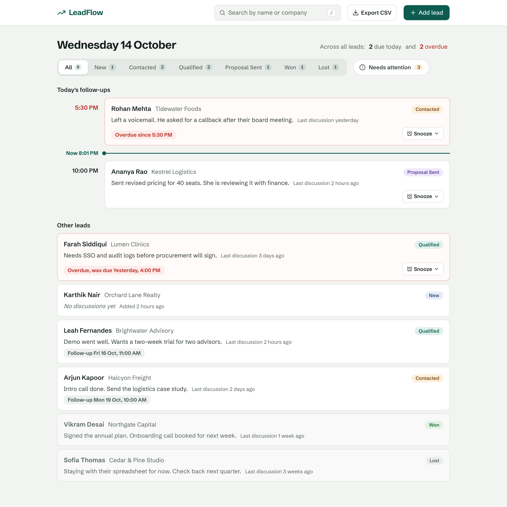
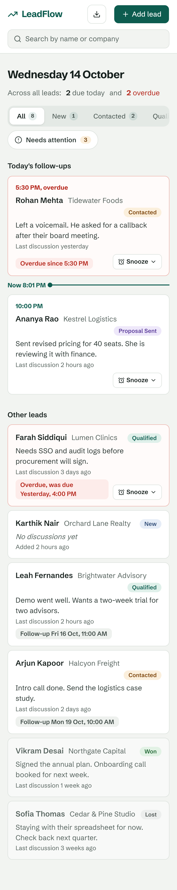
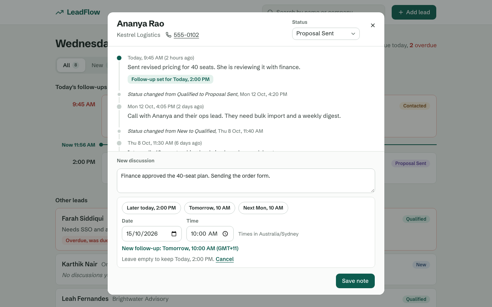
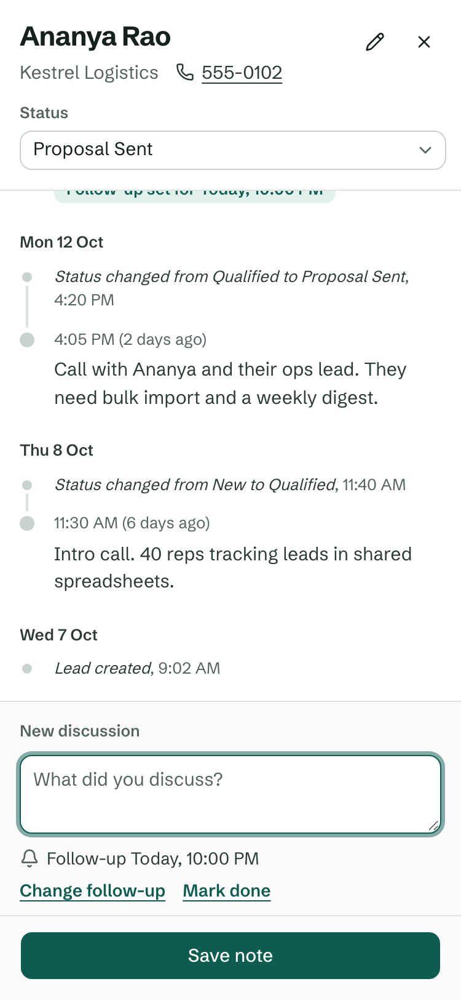

# LeadFlow

A single-screen lead tracker for a sales rep: see every lead at a glance, keep a timeline of every
discussion, and never miss a follow-up. Built for the PravarAI fullstack assessment with
**Next.js 16 + FastAPI**.

**Demo video:** [docs/demo.mp4](docs/demo.mp4) (57 s) walks through the evaluation checklist in order.

| Desktop | Phone (375 px) |
|---|---|
|  |  |
|  |  |

## What it does

- **Lead list.** Every lead shows its name, company, status badge, latest discussion and how long
  ago it was. Won and Lost leads are faded.
- **Today's follow-ups, pinned.** Follow-ups due today sit at the top as a day planner with a
  *Now* line: ones whose time has passed are above it in red, upcoming ones below. Older overdue
  follow-ups head the rest of the list in red. A lead appears exactly once.
- **Timeline dialog.** Clicking a lead opens its history (newest first) in a dialog. Status
  changes and follow-up updates are recorded as compact system entries.
- **Log a discussion** with an optional follow-up (shortcuts: later today, tomorrow 10 AM, next
  Monday 10 AM). Saving updates the lead's follow-up and the list immediately, without a reload.
- **Change status** from the dialog (New, Contacted, Qualified, Proposal Sent, Won, Lost). It is
  saved and logged in the timeline.
- **Add a lead.** Name is required; company and phone are optional; status starts as New.
- **Bonus:** search by name or company, status filters with counts, overdue follow-ups in red,
  and a seed script with 8 fictional leads.

Also: full keyboard support (focus stays inside dialogs and returns to the card you opened),
works on phones (the dialog becomes full screen with a pinned Save button), respects reduced
motion, and asks before discarding an unsaved note.

## Run it locally

You need **Python 3.12** with [uv](https://docs.astral.sh/uv/) and **Node.js 20.9+** (tested on
Node 24).

**1. Backend** (FastAPI on http://localhost:8000)

```bash
cd backend
uv sync
uv run python -m app.seed                                    # 8 demo leads (only into an empty database)
uv run uvicorn app.main:create_app --factory --reload --port 8000
```

API docs: http://localhost:8000/docs. To reload fresh demo data later, run
`uv run python -m app.seed --reset` (this **deletes everything** in the database first).

**2. Frontend** (Next.js on http://localhost:3000), in a second terminal

```bash
cd frontend
npm ci
npm run dev
```

Open http://localhost:3000. For a production build use `npm run build && npm start`.

**Configuration.** Everything works with the defaults. To change them, copy the matching
section of [`.env.example`](.env.example) to `backend/.env` and/or `frontend/.env.local`:

| Variable | Used by | Default |
|---|---|---|
| `DATABASE_URL` | backend | `sqlite:///./leadflow.db` (in `backend/`) |
| `CORS_ORIGINS` | backend | `http://localhost:3000` |
| `NEXT_PUBLIC_API_URL` | frontend (baked in at build time) | `http://localhost:8000/api` |

## Tests

| Suite | Command | What it covers |
|---|---|---|
| Backend (pytest, 83 tests) | `cd backend && uv run pytest` | Validation, status codes and error format, pinned/overdue rules with a frozen clock, DST days in New York and Santiago, timeline order, search and filters, concurrent saves, persistence across restarts, the seed |
| Frontend unit (21 tests) | `cd frontend && npm test` | Time helpers (calendar-relative wording, DST gaps and repeats) and list request handling (results tied to their filter, overlapping refreshes) |
| Browser (Playwright, 9 tests) | `cd frontend && npx playwright install chromium && npm run test:e2e` | The full workflow end to end, the phone layout with the keyboard open, keyboard focus, and failure cases (failed save, failed refresh, overlapping refreshes) |
| Lint and types | `cd backend && uv run ruff check .` · `cd frontend && npm run lint && npm run typecheck` | |

The browser tests never touch your local app or its data. They start their own API on port 8100
(with a throwaway `backend/e2e.db`) and their own production build on port 3100. The demo
video and screenshots are produced the same way by `npm run demo:record` (ports 8200/3200,
`backend/demo.db`; set `DEMO_TZ`, e.g. `DEMO_TZ=Asia/Kolkata`, to choose the time zone).

## How it is built

```
backend/   FastAPI + SQLAlchemy 2 + SQLite
  app/main.py              app factory, CORS, error handlers; every route under /api
  app/routers/leads.py     thin HTTP layer
  app/services/leads.py    all business rules
  app/models.py            Lead and Entry tables (UTC timestamps)
  app/seed.py              demo data, written through the service layer
  tests/
frontend/  Next.js 16 (App Router) + TypeScript + Tailwind + shadcn/ui
  components/leadflow/     the screen: agenda, lead card, timeline dialog, composer, add-lead dialog
  hooks/use-leads.ts       list loading, polling and refresh outcomes
  lib/api.ts               typed API client with user-facing error messages
  lib/list-loader.ts       request bookkeeping (framework-free, unit-tested)
  lib/time.ts              local-time formatting and DST-safe parsing (unit-tested)
  e2e/                     Playwright tests
```

### API

| Method | Path | Success | Errors |
|---|---|---|---|
| GET | `/api/health` | 200 | |
| GET | `/api/leads?status=&q=&tz=` | 200 `{pinned, leads}` | 422 |
| POST | `/api/leads` | **201** `{lead, entry}` | 422 |
| GET | `/api/leads/{id}` | 200 | 404 |
| PATCH | `/api/leads/{id}` `{status}` | 200 `{lead, entry}` | 404, 422 |
| GET | `/api/leads/{id}/timeline` | 200 | 404 |
| POST | `/api/leads/{id}/discussions` `{note, follow_up_at?}` | **201** `{lead, entry}` | 404, 422 |
| DELETE | `/api/leads/{id}/follow-up` | 200 `{lead, entry}` | 404 |

Every change returns the updated lead and the timeline entry it wrote (`entry` is `null` when
nothing changed, e.g. setting the same status), so the open dialog never misses activity. Every
error, including FastAPI's own validation errors, has one shape:
`{"error": {"code": "...", "message": "...", "details": [{"field": "...", "message": "..."}]}}`.

### Rules worth knowing

- **Time zones.** Times are stored in UTC. The browser sends its time zone, and the server
  decides what "today" means in that zone, so 23- and 25-hour DST days are handled. A follow-up
  must be in the future; a time skipped by a DST change is rejected with a clear message.
- **Last discussion** means the newest note; status changes never replace it.
- **Status changes never delete anything.** Moving a lead to Won or Lost keeps its follow-up.
  Setting the same status again is a no-op.
- **A note without a follow-up keeps the existing one.** Use *Mark done* to clear it.
- **Concurrent saves are safe.** Write transactions take SQLite's write lock before reading the
  clock, so the latest set-or-clear always decides a lead's follow-up. Reads never wait for writers.
- **The list is always the server's latest answer** for the current filter and search. A save is
  reported as saved even if the list then fails to refresh; that case says so separately and offers
  a retry (also inside the open dialog, for keyboard users) rather than suggesting the save failed.
- **Counts are across all leads**, whatever filter or search is active.

### Components

shadcn/ui on Radix primitives (dialogs, select, inputs, toasts) is the foundation. The status
filter is the [affectUI](https://github.com/flohoeller/affectui) segmented control (MIT), themed to
the app's palette. Other libraries were evaluated and left out where they added dependencies
without improving the design.

## Limitations

- **No login.** The brief marks it optional, so this is a single-user app: anyone who can reach
  the API can read and change every lead. Run it locally; if you ever put it online, use a
  throwaway deployment with fictional data only, keep `CORS_ORIGINS` limited to the frontend's
  address, and tear it down afterwards.
- All demo data is fictional (`555-01xx` numbers, made-up people and companies).
- No pagination: the list loads every lead, which suits the size of this assessment.
- SQLite with a single API process. Moving to Postgres would need connection settings and a
  different locking approach.
